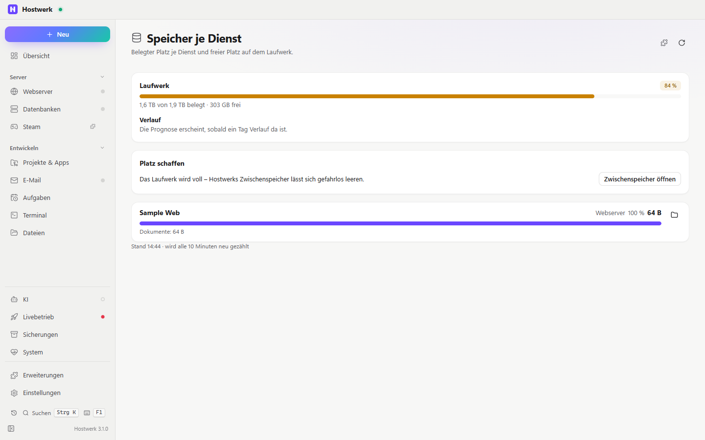

# Speicher je Dienst

> **Aufgegangen in „Laufwerke“ (Erweiterung `disk-health` 2.0):** Die Belegung je Dienst ist jetzt der Teil „Belegung“ unter System → Laufwerke. Hostwerk installiert „Laufwerke“ von selbst, übernimmt den Verlauf und entfernt diese Erweiterung. Hier gibt es keine neuen Fassungen mehr.

Wie viel Platz jeder Dienst belegt – Daten, Sicherungen, Projekte – und wie voll das Laufwerk ist. Mit Kachel für die Übersicht.

[English](README.md) · Offizielle [Hostwerk](https://github.com/Passimoritz/hostwerk-public)-Erweiterung (läuft abgeschottet, ab Hostwerk 2.9)

## Was sie kann

Eine Seite unter System → Speicherplatz und eine Kachel für die Übersicht, im Design von Hostwerk, auf Deutsch und Englisch.

- Jeder Dienst mit Größe, Anteil am Platz aller Dienste und seinen Teilen (Server, Sicherungen, Daten …)
- Laufwerksbalken mit Warnstufen ab 80 % und 90 %
- **Verlauf und Prognose:** Die Belegung wird stündlich notiert (90 Tage, im Speicher der Erweiterung) – „+1,2 GB pro Tag · bei diesem Tempo voll in etwa 40 Tagen“
- **Platz schaffen:** Dienste, deren Sicherungen viel Platz brauchen, und bei vollem Laufwerk Hostwerks Zwischenspeicher – jeweils mit Knopf, der die richtige Stelle öffnet
- Der Ordner-Knopf öffnet die Dateien des Dienstes (Minecraft: Reiter *Dateien*)
- Spiele-Server und Docker-Volumes zählen mit (ab Hostwerk 3.0) – mit Filter nach Art und dem Platz je Art
- Balken für Bildschirmleser lesbar (`role="meter"`), Uhrzeit und Zahlen in der Sprache von Hostwerk
- Ladefehler zeigen eine Meldung mit *Erneut versuchen*; bei verstecktem Reiter wird nicht nachgezählt

## Installieren

In Hostwerk: **Erweiterungen → Entdecken** und „Installieren“ klicken. Oder von Hand: die Zip-Datei aus dem [neuesten Release](../../releases/latest) laden → *Erweiterungen → Hinzufügen → Datei*.

Sie läuft abgeschottet in Hostwerk – sie bekommt nur die Rechte, die sie nennt, und Hostwerk zeigt sie vor dem Installieren.

## Rechte

**Wo:** System → Speicherplatz und Übersichtskachel – seit 1.4.0 ohne eigenen Seitenleisten-Eintrag; die ganze Seite bleibt unter Erweiterungen → Öffnen

| Recht | Wofür |
|---|---|
| `read:system` | Speicher je Dienst und Laufwerk (nur lesen) |
| `storage` | Merkt sich den Verlauf für die Prognose |

Sie ändert selbst nichts – die Knöpfe öffnen nur Bereiche von Hostwerk.

Andere Erweiterungen dürfen Reiter auf ihrer Seite ergänzen (`allowExtensions`).

## Entwickeln

Logik in `page/lib.js` (ohne DOM), Tests: `node --test tests/*.test.js`. Prüfen: `node check.js . --strict` (Hostwerk-SDK).

## Lizenz

MIT
