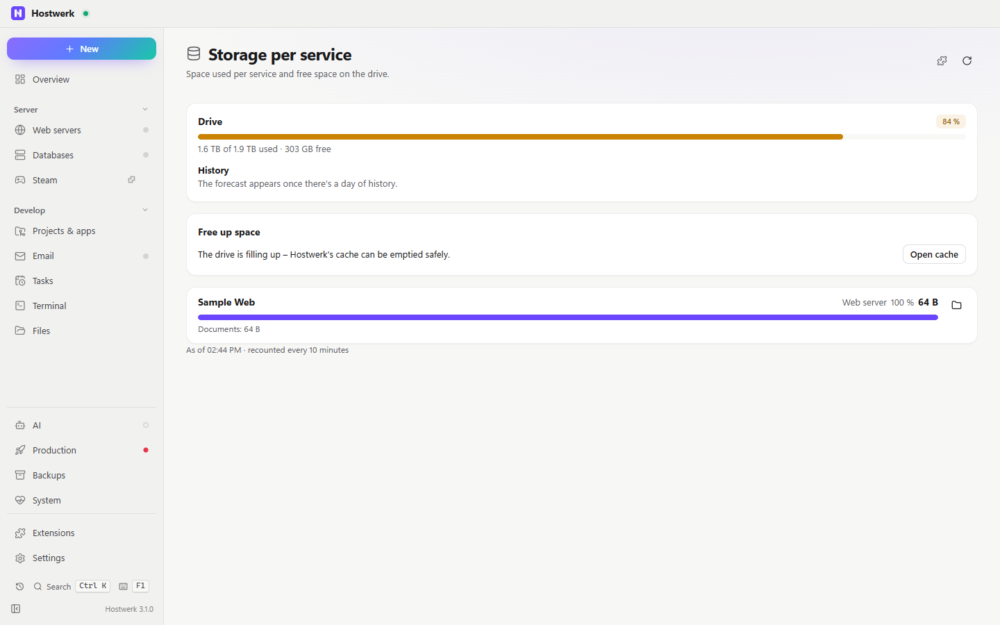

# Storage per service

How much space each service takes – data, backups, projects – and how full the drive is. With a dashboard tile.

[Deutsch](README.de.md) · An official [Hostwerk](https://github.com/Passimoritz/hostwerk-public) extension (runs sandboxed, Hostwerk 2.9 or newer)

## What it does

A page under System → Disk usage and a dashboard tile, in Hostwerk's own design, German and English.

- Every service with its size, its share of the space of all services and its parts (server, backups, data …)
- Drive bar with warning levels from 80 % and 90 %
- **History and forecast:** the drive usage is noted once an hour (90 days, in the extension's own storage) – “+1.2 GB per day · at this rate full in about 40 days”
- **Free up space:** services whose backups take a lot of room and, on a full drive, Hostwerk's cache – each with a button that opens the right place
- A click on the folder button opens the service's files (Minecraft: the *Files* tab)
- Game servers and Docker volumes count along (Hostwerk 3.0 and newer) – with a filter by kind and the space per kind
- Bars readable for screen readers (`role="meter"`), times and numbers in Hostwerk's language
- Loading errors show a message with *Try again*; nothing is recounted while the page is hidden

## Install

In Hostwerk: **Extensions → Discover** and click “Install”. Or manually: download the zip from the [latest release](../../releases/latest) → *Extensions → Add → File*.

It runs sandboxed in Hostwerk – it only gets the permissions it lists, and Hostwerk shows them before installing.

## Permissions

**Where:** System → Disk usage and the dashboard tile – no own sidebar entry since 1.4.0; the full page stays under Extensions → Open

| Permission | Why |
|---|---|
| `read:system` | Storage per service and drive (read only) |
| `storage` | Keeps the history for the forecast |

It changes nothing on its own – the buttons only open Hostwerk areas.

Other extensions may add tabs to its page (`allowExtensions`).

## Develop

Logic in `page/lib.js` (no DOM), tests: `node --test tests/*.test.js`. Check: `node check.js . --strict` (Hostwerk SDK).

## License

MIT
